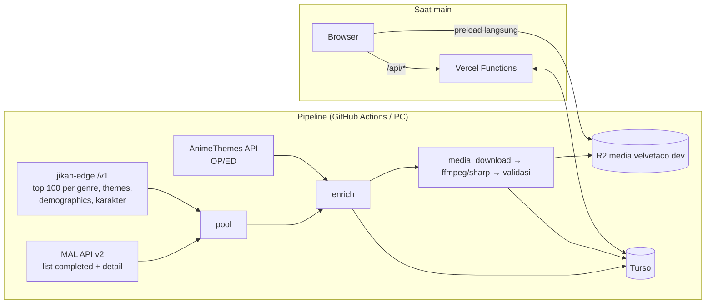

# Anidle: Plan

Game tebak anime harian (mirip aniguessr.com) khusus untuk saya dan teman-teman.
Domain: `https://anidle.velvetaco.dev` · Repo GitHub terpisah dari portofolio · Semua layanan di paket gratis.

## 1. Tujuan & prinsip

1. **Pool anime terbatas**: hanya anime yang ada di list *completed* MAL teman-teman, dan/atau top 100 per genre.
2. **Tidak lemot, tidak gagal fetch**: masalah utama aniguessr. Prinsipnya:
   - Saat main **tidak ada request ke MAL / jikan-edge / AnimeThemes**. Semua data dan media sudah disalin ke database & storage sendiri.
   - Media **divalidasi saat pipeline**. Judul yang medianya rusak tidak masuk pool, jadi tidak ada ronde yang tidak bisa dijawab.
   - Satu request untuk satu game, lalu **semua media ronde di-preload** sebelum game mulai.
3. **Jawaban dicek di server**: kunci jawaban tidak pernah dikirim ke browser (beda dengan mode screenshot aniguessr yang mengirim `accepted_titles`).
4. **Terbuka, akun opsional**: siapa pun bisa main tanpa akun. Akun Anidle (username + password) menyimpan progres lintas perangkat; menghubungkan MAL membuka pool dari list completed.

## 2. Stack (semua gratis)

| Bagian | Pakai | Catatan kuota (per Okt 2026) |
| --- | --- | --- |
| Web + API | **Vercel Hobby**: Vite + React + TypeScript, Vercel Functions di `api/` | Function maks 300 dtk, cron maks 1×/hari, non-komersial |
| Database | **Turso** (libSQL/SQLite) via `@libsql/client` | 5 GB, 500 jt baris dibaca/bulan. Lokal pakai file `file:./data/anidle.db` dengan client yang sama |
| Media | **Cloudflare R2**, custom domain `media.velvetaco.dev` | 10 GB, egress gratis. Aktivasi mungkin minta kartu (cek saat daftar) |
| Pipeline | **GitHub Actions** (jadwal mingguan + manual) atau PC lokal | Private repo: 2.000 menit/bulan. Run pertama sebaiknya di PC |
| Proses media | `ffmpeg-static` (audio) + `sharp` (gambar) dari npm | ffmpeg belum ter-install di PC; paket npm ini menghindari install manual |
| Login | Akun sendiri: username + password (scrypt) + cookie session ber-HMAC. Pemain anonim pakai cookie id acak. **MAL OAuth2 PKCE `plain`** hanya untuk *menghubungkan* akun MAL | App MAL **kedua** untuk produksi (MAL hanya izinkan 1 redirect URL per app) |
| Test | Vitest untuk logika di `shared/` | |

DNS `velvetaco.dev` sudah di Cloudflare (NS `mckinley`/`agustin.ns.cloudflare.com`, ada wildcard `*` ke portofolio):
- `anidle` → CNAME ke Vercel, **DNS only** (awan abu-abu). Record eksplisit mengalahkan wildcard.
- `media` → R2 custom domain (dibuat otomatis dari dashboard R2). Subdomain satu tingkat saja (sertifikat `*.velvetaco.dev`).
- Record `@`, `www`, `*`, MX **tidak disentuh**.

## 3. Arsitektur



## 4. Sumber data (sudah dicek live)

| Sumber | Dipakai untuk | Endpoint | Batas |
| --- | --- | --- | --- |
| MAL API v2 | list completed teman, judul alternatif, cover, tahun/season, skor, source, studio, relasi | `GET /v2/users/{user}/animelist?status=completed&limit=1000&fields=list_status,media_type&nsfw=true`, `GET /v2/anime/{id}?fields=…` | Tidak terdokumentasi → jaga ±1 req/dtk |
| jikan-edge | top per genre, genres/themes/demographics terpisah, karakter + gambar | `GET /v1/anime?genres={id}&order_by=score&sort=desc&page=N` (50/halaman), `GET /v1/anime/{id}`, `GET /v1/anime/{id}/characters`, `GET /v1/genres/anime` | 30 req/10 dtk, 60 req/menit per IP |
| AnimeThemes | file OP/ED | `GET https://api.animethemes.moe/anime?filter[has]=resources&filter[site]=MyAnimeList&filter[external_id]={mal_id}&include=animethemes.animethemeentries.videos.audio` (bracket harus di-URL-encode) | Header `x-ratelimit-limit: 90` |

Contoh hasil AnimeThemes untuk Frieren (52991): `OP1`, `ED1`, `OP2`, masing-masing ada audio `.ogg` ±2–3,7 MB (lagu penuh) dan video `.webm` 720p. Jadi audio wajib dipotong.

Playground `D:\Personal Project\MAL-WebAPI` dipakai untuk uji coba query sebelum masuk pipeline.

## 5. Pool

- **Completed**: per username MAL, ambil semua halaman `animelist?status=completed`. List publik cukup Client ID; list private pakai token MAL akun yang sudah menghubungkannya. Pool bersama hanya dari `POOL_USERS`; akun lain yang menghubungkan MAL hanya mengisi pool `saya` miliknya.
- **Top 100 per genre**: 18 genre utama jikan-edge (Action 1, Adventure 2, Avant Garde 5, Award Winning 46, Boys Love 28, Comedy 4, Drama 8, Fantasy 10, Girls Love 26, Gourmet 47, Horror 14, Mystery 7, Romance 22, Sci-Fi 24, Slice of Life 36, Sports 30, Supernatural 37, Suspense 41). Ambil 3–4 halaman per genre, buang `members < 30.000`, ambil 100 teratas.
- **Filter global**: buang `media_type` `music`, `cm`, `pv`; buang explicit genre Hentai (12) dan Erotica (49). Ecchi tetap boleh.
- Setiap judul menyimpan asalnya: `completed_by` (daftar username) dan `top_genres`. Dari sini bisa dibuat pilihan pool di mode unlimited:
  - `semua`: gabungan semua (dipakai puzzle harian),
  - `teman`: completed minimal 1 teman,
  - `bareng`: completed semua teman yang aktif,
  - `saya`: completed akun MAL milik pemain (butuh MAL terhubung; begitu juga `teman` dan `bareng`),
  - `top-genre`: top 100 per genre, bisa dipilih genrenya.
- **Franchise**: dihitung dari relasi MAL `prequel`/`sequel` (graph terhubung → `franchise_id`). Dipakai untuk aturan jawaban (lihat §8).

Estimasi: 18 × 100 = ≤1.800 judul (banyak dobel) + list completed teman → ratusan sampai ±2.000 judul.

## 6. Media

| Jenis | Sumber | Proses | Target ukuran |
| --- | --- | --- | --- |
| Cover | MAL `main_picture.large` | sharp → webp lebar 400 | ±30–50 KB |
| OP/ED | AnimeThemes audio `.ogg` | ffmpeg: 30 dtk dari awal, `loudnorm`, mp3 96 kbps | ±360 KB |
| Karakter | jikan-edge `imageUrl` | sharp → webp lebar 300 | ±20–30 KB |
| Screenshot (belakangan) | frame dari video OP/ED AnimeThemes | ffmpeg ambil 3–5 frame, buang frame gelap/blank | ±40–60 KB |

- Awal: hanya OP1 + ED1 per judul. Run pertama ±2.000 × 2 × ±3,5 MB ≈ **±14 GB download**, output ±1,5 GB → jalankan di PC, file sumber dihapus setelah diproses.
- **Validasi** setiap file: ukuran minimal, `ffprobe` durasi ≥ 20 dtk, `sharp().metadata()` bisa dibaca. Gagal → tandai `broken`, judul tidak dipakai untuk mode yang butuh media itu.
- **Layout R2** (nama file berisi hash, jadi bisa di-cache selamanya):
  ```
  v1/anime/{mal_id}/cover-{hash}.webp
  v1/anime/{mal_id}/op1-{hash}.mp3
  v1/anime/{mal_id}/ed1-{hash}.mp3
  v1/char/{char_id}-{hash}.webp
  v1/titles-{hash}.json        # daftar judul untuk autocomplete
  ```
  Semua di-upload dengan `Cache-Control: public, max-age=31536000, immutable`.
- Nama file media tidak boleh membocorkan jawaban (pakai `mal_id` + hash, bukan judul). Browser yang membuka devtools masih bisa melihat `mal_id`; untuk teman-teman ini dianggap cukup. Kalau perlu nanti diganti ID acak per puzzle.

## 7. Database (Turso)

```text
anime(mal_id PK, title, title_en, title_ja, synonyms JSON, media_type, year, season,
      score, members, source, studios JSON, franchise_id, cover_key, nsfw, updated_at)
genre(id PK, name, type)                       -- genres | explicit_genres | themes | demographics
anime_genre(mal_id, genre_id)
theme_song(id PK, mal_id, kind OP|ED, seq, title, artist, audio_key, status ok|broken)
character(id PK, mal_id, name, role, favorites, image_key, status)
player(username PK, mal_user_id, avatar, allowed, refresh_token_enc, token_expires_at, last_sync_at)
completed(username, mal_id, finished_at, PK(username, mal_id))
top_genre(genre_id, mal_id, rank, PK(genre_id, mal_id))
enrich_queue(mal_id PK, reason, added_at)      -- judul baru dari "sync list", diproses pipeline berikutnya
puzzle(id PK, date NULL, mode, pool, rounds JSON, created_at)   -- UNIQUE(date, mode) untuk harian
play(id PK, puzzle_id, username, round, guesses JSON, score, finished_at)
```

Puzzle harian **disimpan** saat pertama diminta (dipilih dari seed `tanggal+mode`), supaya update pool di tengah hari tidak mengubah puzzle yang sedang dimainkan.

## 8. Game

**Mode** (urutan pengerjaan):
1. **Anidle**: tebak anime hari ini dari petunjuk. Setiap tebakan dibandingkan dengan jawaban: tahun (`<`/`>`/sama), skor MAL (`<`/`>`), source, studio, genres, themes, demographics (cocok/sebagian). Tidak butuh media kecuali cover saat jawaban terbuka.
2. **Opening** dan **Ending**: 3 ronde, audio diputar bertahap (1 → 3 → 6 → 12 → 30 dtk), poin turun setiap reveal/salah.
3. **Karakter**: 4 portrait karakter dari satu anime per ronde.
4. **Screenshot**: dari frame video OP/ED.

**Jawaban**:
- Pemain memilih judul dari autocomplete (yang dikirim `mal_id`), bukan teks bebas. Autocomplete mencari di judul romaji, Inggris, Jepang, dan sinonim setelah normalisasi (huruf kecil, tanpa tanda baca/makron).
- Benar kalau `mal_id` sama, **atau** satu `franchise_id` (default, lihat §12).
- Server menyimpan setiap tebakan di `play`. Reload halaman melanjutkan progres, tidak mengulang.

**Harian vs unlimited**: harian = satu puzzle per mode per tanggal (WIB), pool `semua`, masuk leaderboard. Unlimited = puzzle acak, pool bisa dipilih, tidak masuk leaderboard.

## 9. API (Vercel Functions)

| Route | Fungsi |
| --- | --- |
| `POST /api/auth/register` · `POST /api/auth/login` · `POST /api/logout` | Akun Anidle (username + password). Progres anonim di browser itu dipindah ke akun |
| `GET /api/oauth/login` · `GET /api/oauth/callback` · `POST /api/mal/unlink` | Hubungkan / putuskan akun MAL (butuh akun Anidle) |
| `GET /api/me` | Akun yang masuk + status MAL |
| `POST /api/sync` | Sync list completed akun MAL yang terhubung. Judul baru masuk `enrich_queue` |
| `GET /api/puzzle?mode=&date=` · `POST /api/puzzle/unlimited` | Puzzle tanpa jawaban: ronde + URL media R2 |
| `POST /api/guess` | `{puzzleId, round, malId}` → benar/salah, petunjuk (Anidle), skor |
| `GET /api/leaderboard?date=&mode=` | Skor teman per hari/mode |

Puzzle, tebakan, dan daftar judul terbuka untuk semua orang; pemain diidentifikasi lewat session akun atau cookie anonim (`HttpOnly`, `SameSite=Lax`, `Secure` di HTTPS). Pool `teman`/`bareng`/`saya` butuh MAL terhubung (403 kalau belum).

## 10. Frontend

- Vite + React + TypeScript. Halaman: Home (pilih mode), Game, Hasil + share, Leaderboard, Akun (sync list, pilih pool).
- **Preload**: setelah `/api/puzzle`, semua media ronde dimuat (`Audio` dengan `preload="auto"` + `canplaythrough`, `Image().decode()`) dengan progress bar. Game mulai setelah semua siap.
- **Fallback**: media yang tetap gagal dimuat → panggil `/api/puzzle/replace-round`, ronde diganti judul lain, skor tidak dipotong.
- `titles.json` diambil dari R2 sekali dan disimpan di cache browser (nama file berisi hash, jadi otomatis segar saat pool berubah).

## 11. Struktur repo `D:\Personal Project\Anidle`

```
src/                 React app
api/                 Vercel Functions (oauth, me, sync, puzzle, guess, leaderboard)
shared/              logika bersama + test: seed, normalisasi judul, franchise, perbandingan Anidle, skor
pipeline/            sources/ (mal, jikanEdge, animeThemes), pool.ts, enrich.ts, media.ts, upload.ts, index.ts
db/                  schema.sql + migrations
.github/workflows/   pipeline.yml (cron mingguan + workflow_dispatch)
.env.example
```

**Environment variable**:

| Variabel | Dipakai di | Isi |
| --- | --- | --- |
| `MAL_CLIENT_ID`, `MAL_CLIENT_SECRET` | api, pipeline | App MAL produksi |
| `MAL_REDIRECT_URI` | api | `https://anidle.velvetaco.dev/oauth/callback` (di-rewrite ke `/api/oauth/callback`) |
| `TURSO_DATABASE_URL`, `TURSO_AUTH_TOKEN` | api, pipeline | Lokal: `file:./data/anidle.db` |
| `R2_ACCOUNT_ID`, `R2_ACCESS_KEY_ID`, `R2_SECRET_ACCESS_KEY`, `R2_BUCKET` | pipeline | API token R2 |
| `MEDIA_BASE_URL` | api | `https://media.velvetaco.dev` |
| `SESSION_SECRET`, `TOKEN_ENC_KEY` | api, pipeline | Acak 32 byte. Refresh token MAL dienkripsi AES-GCM |
| `POOL_USERS` | api, pipeline | Username MAL yang list completed-nya membentuk pool bersama, dipisah koma |
| `JIKAN_BASE_URL` | pipeline | Default `https://jikan.lucashdo.com` |

## 12. Keputusan (default dipilih, bisa diubah)

| Pertanyaan | Default | Alternatif |
| --- | --- | --- |
| "Setiap genre" untuk top 100 | 18 genre utama saja | + themes/demographics (pool jauh lebih besar) |
| Season 2/3 | Entri MAL terpisah di pool; jawaban satu franchise dianggap benar | Hanya entri persis yang benar |
| Ambang popularitas top genre | `members ≥ 30.000` | Lebih ketat/longgar |
| Konten | Tanpa Hentai/Erotica | Ikutkan dengan toggle |
| Zona waktu puzzle harian | WIB (UTC+7) | UTC |
| Mode pertama | Anidle (tanpa media), lalu Opening/Ending | Opening dulu |

## 13. Milestone

| # | Isi | Selesai kalau | Status |
| --- | --- | --- | --- |
| M0 | Setup: repo GitHub, project Vercel, domain `anidle.velvetaco.dev`, DB Turso, bucket R2 + `media.velvetaco.dev`, app MAL kedua | `https://anidle.velvetaco.dev/api/health` membalas OK dan bisa query Turso | belum (butuh akun) |
| M1 | Pipeline data (tanpa media): pool completed + top genre, enrich MAL + jikan-edge, franchise, simpan ke DB lokal lalu Turso. Bisa diulang tanpa duplikat, patuh rate limit | Laporan jumlah judul per sumber; detail beberapa judul cocok dengan MAL | ✓ lokal (pool 1.426 judul) |
| M2 | Akun (username + password) + main anonim + hubungkan MAL + sync list, mode **Anidle** harian & unlimited, autocomplete, `/api/guess` | Bisa main tanpa akun; teman bisa daftar, hubungkan MAL, dan main pool completed; progres tersimpan saat reload | ✓ lokal |
| M3 | Pipeline media (cover, OP1, ED1) → R2, mode **Opening** & **Ending** dengan preload + fallback | Satu game dimulai < 3 dtk setelah preload di koneksi biasa; tidak ada ronde gagal | |
| M4 | Mode **Karakter** | | |
| M5 | Leaderboard, riwayat, share skor | | |
| M6 | Screenshot dari video OP/ED + halaman admin untuk menandai media jelek | | |
| M7 | GitHub Actions mingguan, proses `enrich_queue`, laporan media broken | Pipeline jalan otomatis tanpa PC | |

Catatan implementasi M1–M2 (beda dari rencana awal):
- Daftar judul autocomplete masih lewat `/api/titles` (±1.400 judul, ETag), belum file di R2. Pindah ke R2 di M3.
- Cover masih langsung dari `cdn.myanimelist.net`; diganti salinan di R2 di M3.
- State OAuth (state + PKCE verifier) disimpan di cookie bertanda tangan, karena serverless tidak punya memori antar request.

## 14. Risiko

- **jikan-edge / AnimeThemes layanan pihak ketiga**: kalau mati, hanya update pool yang terganggu; game jalan dari data yang sudah disalin. Sumber dibungkus di `pipeline/sources/` supaya mudah diganti (mis. AniList untuk genre).
- **List completed private**: butuh pemiliknya menghubungkan MAL sekali; token disimpan terenkripsi dan di-refresh otomatis.
- **Run pertama media besar** (±14 GB download): di PC, bisa dicicil (pipeline melewati judul yang sudah `ok`).
- **Hak cipta media OP/ED**: web sekarang terbuka untuk umum (main anonim), jadi media M3 juga bisa diakses siapa pun. Tanpa iklan; kalau perlu, media bisa dibatasi ke akun yang masuk.
- **Batas Vercel Hobby**: repo di akun GitHub pribadi (bukan organization); commit dari orang lain ke repo private bisa membuat deploy tertahan.

## 15. Yang dibutuhkan dari kamu

1. Daftar username MAL teman untuk `POOL_USERS`, dan apakah list mereka publik.
2. Konfirmasi atau ubah default di §12.
3. Untuk M0: akun Turso, Cloudflare (aktifkan R2), app MAL kedua dengan redirect `https://anidle.velvetaco.dev/oauth/callback`, repo GitHub kosong.
